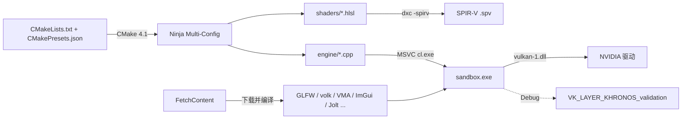

# 00 · 环境与工程约定（M0）

## 这一步解决什么问题
在写第一行引擎代码之前，先把「工具链是否齐全」和「工程怎么组织」定下来。后面所有里程碑都假设这里的约定成立。

## 工具链

| 组件 | 作用 | 为什么选它 |
|---|---|---|
| MSVC（VS 2026） | C++20 编译器 | 开发机已装 VS 2026；它向下兼容 VS 2022 的工程写法 |
| CMake + Ninja Multi-Config | 构建系统 | 一个构建目录同时容纳 Debug/Release；Ninja 比 MSBuild 增量构建更快 |
| FetchContent | 依赖管理 | 依赖版本写死在 CMake 里，clone 下来一条命令就能构建，不需要 vcpkg |
| Vulkan SDK | validation layer、dxc | validation layer 是学习 Vulkan 的「老师」；dxc 把 HLSL 编译成 SPIR-V |
| RenderDoc | 帧捕获 | 看每个 pass 的输入输出、barrier、资源内容，调 shader 必备 |

### 与需求的偏差
- **VS 2026 而不是 VS 2022**：开发机装的是 VS 2026（18.x），工具集 14.50 完整支持 C++20。CMake 工程本身不绑定 VS 版本。
- **Ninja 而不是 VS 生成器**：VS 自带 CMake 4.1 + Ninja，用 `scripts/build.ps1` 进入 VS 开发者环境后构建；VS IDE 也能直接打开文件夹使用同一份 `CMakePresets.json`。
- **CMake 4.x 注意**：CMake 4 移除了对 `cmake_minimum_required(VERSION < 3.5)` 的兼容。部分老依赖（如 doctest）仍写着 3.0，需要设 `CMAKE_POLICY_VERSION_MINIMUM=3.5`，M1 的根 CMakeLists 会处理。

### 双显卡笔记本
开发机同时有 Intel 核显与 RTX 5060 Laptop。Vulkan 会枚举出两个物理设备，**引擎必须优先选择独显**（`VK_PHYSICAL_DEVICE_TYPE_DISCRETE_GPU`），否则性能会差很多，且某些特性不可用。M1 的设备选择会处理并在日志里打印选中的 GPU。

## 工程约定
- **模块依赖单向**：`core ← platform ← rhi ← render ← 特性模块`。每个模块一个 CMake target（`engine_core` 等），用 `target_link_libraries` 表达依赖——依赖方向错了会直接链接/包含失败，而不是悄悄变成一团。
- **扩展点**：代码里用 `// EXTEND:` 标注，每篇笔记末尾汇总。全局搜索 `EXTEND:` 就能列出所有「可以从这里改」的位置。
- **参数数据化**：可调参数在 `config/*.json`，ImGui 改完可保存。
- **每个里程碑单独提交**，提交前 Debug/Release 构建、单元测试、冒烟测试、validation 全部干净。

## 扩展点
| 位置 | 可以改什么 | 注意 |
|---|---|---|
| `scripts/check_env.ps1` | 增加新工具的检查 | 保持 ASCII：Windows PowerShell 5.1 会把无 BOM 文件按 ANSI 读 |
| `.gitattributes` | 新增二进制资源后缀 | 漏写会导致 git 把二进制当文本做换行转换而损坏 |

## 练习
1. 运行 `.\scripts\check_env.ps1`，再打开 `C:\VulkanSDK\<版本>\Bin\vkconfig.exe`（Vulkan Configurator），看看有哪些 layer 可用。
2. 运行 `C:\VulkanSDK\<版本>\Bin\vulkaninfo.exe --summary`，找到两块 GPU 的 `deviceType` 和 `apiVersion`。
3. 用 `dxc -T ps_6_0 -E main -spirv` 编译一个最小 HLSL 像素着色器，再用 `spirv-dis` 看生成的 SPIR-V。
