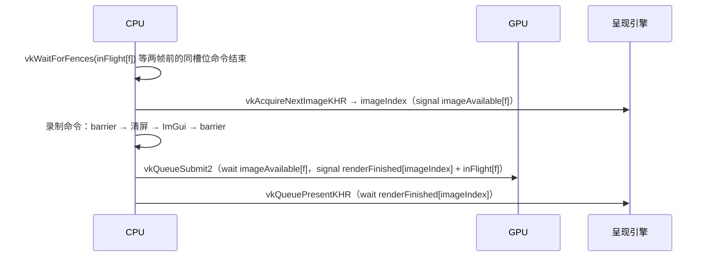

# 01 · 窗口、Vulkan 初始化与主循环（M1）

## 解决的问题
- 创建窗口并把 Vulkan 接到窗口上（instance → surface → device → swapchain）。
- 让 CPU 与 GPU 正确地「流水线」工作：CPU 录制下一帧时 GPU 执行上一帧。
- 窗口缩放、最小化时不崩溃。
- 物理与渲染解耦：固定步长模拟 + 渲染插值。
- 参数放在 `config/engine.json`，可在 ImGui 中修改、保存、热加载。

## 代码地图
| 文件 | 内容 |
|---|---|
| [engine/core/Log.h](../engine/core/Log.h) | 日志；统计 error 条数（冒烟测试据此判定失败） |
| [engine/core/Config.h](../engine/core/Config.h) | JSON 参数文件；缺字段用默认值，坏文件保留旧值 |
| [engine/core/Time.h](../engine/core/Time.h) | `FixedStepLoop`：累加器式固定步长 |
| [engine/platform/Window.h](../engine/platform/Window.h) | GLFW 窗口、缩放/最小化 |
| [engine/rhi/Device.h](../engine/rhi/Device.h) | 实例、选 GPU、设备、VMA、延迟销毁 |
| [engine/rhi/Swapchain.h](../engine/rhi/Swapchain.h) | 交换链创建与重建 |
| [engine/render/Renderer.h](../engine/render/Renderer.h) | 每帧同步：fence、信号量、acquire/submit/present |
| [sandbox/App.cpp](../sandbox/App.cpp) | 主循环 |

## 一帧的数据流

### 为什么 renderFinished 信号量按「交换链图像」分配
present 什么时候用完这个信号量，应用无法直接知道；唯一能确定的时机是**同一张图像再次被 acquire**。
按帧分配会出现「信号量还被呈现引擎持有，就又被下一次 submit 触发」的问题，新版 validation layer 会报错。

### 为什么先 acquire 成功再 reset fence
如果先 reset fence、acquire 却返回 `OUT_OF_DATE` 而跳过本帧，这个 fence 永远不会被 submit 触发，
下一次等待它就会永久阻塞。

## 固定步长主循环

累加器记录「欠下的模拟时间」：

$$acc \leftarrow acc + \min(\Delta t_{frame},\ t_{max})$$

每当 $acc \ge \Delta t_{fixed}$ 就执行一步模拟并 $acc \leftarrow acc - \Delta t_{fixed}$。
剩余时间换算成插值因子：

$$\alpha = \frac{acc}{\Delta t_{fixed}} \in [0, 1)$$

渲染时用 $x_{render} = \operatorname{lerp}(x_{prev}, x_{curr}, \alpha)$，旋转用 slerp。
`maxStepsPerFrame` 防止「越卡越补、越补越卡」的死亡螺旋；`maxFrameTime` 防止断点调试回来后一次补几百步。

## 容错设计
- **config 坏了**：语法错误 → 保留旧值 + 日志报错 + 面板红字；某一节类型错 → 该节用默认值。
- **缺 validation layer**：自动关闭验证并警告，而不是启动失败。
- **最小化**：framebuffer 为 0 时阻塞等待，不创建交换链。
- **冒烟测试**：`sandbox --frames N` 中途会把窗口缩小再恢复，覆盖交换链重建路径；任何 error 日志（包括 validation 报错）→ 返回码 2。
- **截图**：`--capture out.png` 把最后一帧存下来，便于不开窗口也能确认画面。

## 扩展点（`// EXTEND:`）
| 位置 | 可以改什么 | 注意 |
|---|---|---|
| `core/FileSystem.h` FileWatcher | 换成系统文件通知 | 回调里可能 watch/unwatch，先收集再回调 |
| `rhi/Device.cpp` 队列 | 加异步 compute 队列（M5 FFT） | 需要跨队列信号量和所有权转移 barrier |
| `platform/Input.h` | 动作映射、手柄 | ImGui 占用输入时游戏逻辑要忽略 |
| `debug/ImGuiLayer.cpp` kExtraGlyphs | 补充缺失的中文字形 | 全量字库会让图集变得很大 |
| `engine/CMakeLists.txt` ENGINE_ROOT_DIR | 发布时改为相对 exe 的路径 | 热重载依赖它指向源码目录 |

## 练习
1. 把 `kFramesInFlight` 改成 1 和 3，用统计面板对比帧时间，并解释差异。
2. 在 `config/engine.json` 里把 `fixedHz` 改成 10，观察面板里「本帧步数」和 alpha 的变化。
3. 故意把 `Renderer::drawFrame` 里 `vkResetFences` 挪到 acquire 之前，然后疯狂缩放窗口，观察会发生什么。
4. 在 RenderDoc 中启动 sandbox，捕获一帧，找到名为 `ClearAndOverlay` 的标签和 `SwapchainImage0` 等对象名。
