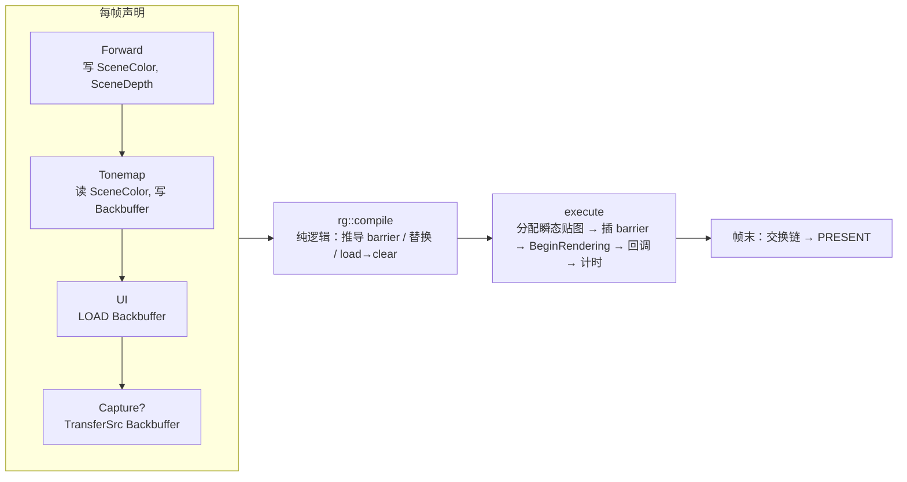

# 02 · RHI、Render Graph 与 Shader 热重载（M2）

## 解决的问题
1. **barrier 写对很难**：Vulkan 要求你显式声明「谁等谁、哪些写入要对谁可见、图像布局怎么变」。手写时漏一个是偶发闪烁，多一个是性能损失；pass 能开关之后，正确组合还会随开关变化。
2. **改 shader 要快、改坏了不能崩**：学习 shader 时要频繁试错，每次重启太慢；写错一次就黑屏/崩溃更让人沮丧。
3. **出问题要看得见**：每个 pass 的耗时、哪个 pass 没跑、为什么没跑、shader 错在哪一行。

## 代码地图
| 文件 | 内容 |
|---|---|
| [engine/render/RenderGraph.h](../engine/render/RenderGraph.h) | pass 声明 API、`rg::compile()` 纯逻辑、GPU 执行 |
| [tests/test_rendergraph.cpp](../tests/test_rendergraph.cpp) | barrier 推导的单元测试（推荐先读，它就是「规格说明」） |
| [engine/render/PipelineCache.h](../engine/render/PipelineCache.h) | 管线登记、热重载、失败保留旧管线 |
| [engine/render/ShaderCompiler.h](../engine/render/ShaderCompiler.h) | 加载 .spv / 运行时调用 dxc、include 依赖 |
| [engine/render/DefaultResources.h](../engine/render/DefaultResources.h) | 黑/白/平坦法线/错误贴图、全局采样器 |
| [engine/render/passes/](../engine/render/passes/) | 每个 pass 一个文件：init 建管线，add 声明读写 |
| [engine/rhi/Descriptors.h](../engine/rhi/Descriptors.h) | 描述符约定（set 0 全局 / set 1 每 pass / push constant） |
| [engine/rhi/GpuProfiler.h](../engine/rhi/GpuProfiler.h) | timestamp query |
| [engine/debug/RenderDocCapture.h](../engine/debug/RenderDocCapture.h) | RenderDoc in-app API |
| [shaders/common/](../shaders/common/) | `frame.hlsli`（set 0）、`mesh.hlsli`（顶点输入）、`fullscreen.hlsli`、`color.hlsli` |

## 一帧的数据流

## barrier 推导规则

每个资源记录一个「当前状态」$S = (\text{stage}, \text{access}, \text{layout})$。对 pass 的每个访问，目标状态 $T$ 由访问类型决定（`stateFor`）。需要 barrier 当且仅当：

$$\text{layout}_S \ne \text{layout}_T \;\lor\; \text{write}_T \;\lor\; \text{write}_S$$

- **RAW**（写后读）：要等写完成并让结果可见 → `srcAccess` 含写访问。
- **WAR**（读后写）：只需等读完成 → `srcAccess = 0`，只有执行依赖。
- **WAW**（写后写）：两个 pass 写同一附件，也要 barrier（不同 render pass 实例之间没有光栅顺序保证）。
- **读后读、布局相同**：不插 barrier，但把两个读者的 stage 合并 $S.\text{stage} \mathrel{|}= T.\text{stage}$，之后的写入会同时等它们。

`srcAccess` 只保留写位（`kWriteMask`）：读操作没有需要「刷出」的数据。
当本次写会覆盖全部旧内容（`CLEAR`/`DONT_CARE`，或资源本帧还没内容）时，`oldLayout = UNDEFINED`，驱动可以省掉保留数据的工作。

**跨帧**：瞬态贴图的初始状态是上一帧的结束状态（布局按 UNDEFINED 丢弃，但 stage 保留），所以本帧第一次写会等上一帧最后一次读——即使两帧都在 GPU 上排队。

## 容错设计
| 情况 | 结果 |
|---|---|
| pass 在面板中被关闭 | 不执行；读它输出的下游改读默认贴图（`TextureDesc::fallback`）；下游若想 LOAD 则自动改为 CLEAR |
| pass 的**必需输入**没有内容（storage 读取、拷贝源） | 默认贴图没有 STORAGE / TRANSFER_SRC 用途、尺寸也对不上，没法替代 → 整个 pass 跳过，输出也不标记为「有内容」，下游按同一规则继续，直到第一个采样读者换成默认贴图。面板显示「↯ 跳过：缺少 X」（M5 后加入，见 [稳定性与故障演练](稳定性与故障演练.md)） |
| 采样读取可能拿到默认贴图（1×1） | shader 里不能对它用 `Load` / 整数下标（越界是未定义行为）；用 `SampleLevel` + clamp 采样器，或在 pass 里 `ctx.hasContent()` 判断后传标志 |
| pass 的管线编译失败（`require()` 返回 false） | 同上，面板显示「未就绪（管线错误）」 |
| 所有写交换链的 pass 都关了 | 帧末清成黑色再 PRESENT，不显示垃圾显存 |
| 只读深度的上游被关 | 改为「清空并写入」，避免读未初始化的深度 |
| 热重载编译失败 | 保留旧管线继续渲染；错误显示在 Shader 面板 + 顶部红色横幅 |
| 启动时就编译失败 | 网格改用错误材质（品红斜条纹）；全屏 pass 被跳过 |
| shader 含中文但无 BOM | dxc 报 `0x80070459`；`build.ps1` 自动修正，热重载错误里会给出提示 |

## 坐标与深度约定
- **负高度视口**：$\text{viewport} = (0,\ h,\ w,\ -h)$，让 NDC 的 $+y$ 朝上，GLM 投影和 glTF 模型都不用改。全屏三角形的 $uv.y = 0$ 对应 $\text{ndc}.y = +1$（屏幕顶部）。
- **反向 Z**：清屏深度 0，比较 `GREATER_OR_EQUAL`，见 [engine/math/Projection.h](../engine/math/Projection.h)。

## 扩展点（`// EXTEND:`）
| 位置 | 可以改什么 | 注意 |
|---|---|---|
| `Renderer::buildGraph` | 加新 pass | 只声明读写；顺序 = 执行顺序 |
| `RenderGraph::realizeTransients` | 瞬态贴图回收 / 显存别名（aliasing） | 别名要求生命周期不重叠，并在复用前加 barrier |
| `rhi/Descriptors.h` | 改为 bindless | 需要 descriptor indexing 特性和 update-after-bind |
| `rhi/Device.cpp` | 异步 compute 队列 | Render Graph 需要支持跨队列同步 |
| `render/Mesh.h` | 第二种顶点格式（蒙皮） | 两种格式要各自一份管线 |
| `RenderGraph` 资源 | 目前只管理图像；缓冲（FFT 中间数据）可加入同样的状态跟踪 | 缓冲没有布局，只有 stage/access |

## 练习
1. 读 `tests/test_rendergraph.cpp`，再加一个测试：compute pass 写 storage image → graphics pass 采样 → 另一个 compute pass 再写。预测 barrier 后再运行。
2. 在 Render Graph 面板里关掉 Forward，观察 Tonemap 读到默认黑图；关掉 Tonemap，观察 UI 的 LOAD 被改为 CLEAR。
3. 运行时把 `shaders/materials/debug_lit.hlsl` 的 `albedo` 改成 `float3(1,0.5,0.2)`，保存，看画面立即更新；再故意写错一行，看横幅和面板。
4. 加一个 pass：在 Tonemap 之前把 SceneColor 的亮部提取到半分辨率贴图（`scale = 0.5`），观察面板里新出现的 barrier 与 GPU 耗时。
5. 用 `--renderdoc` 启动，按 F12 捕获，在 RenderDoc 的 Event Browser 里找到 `Forward`、`Tonemap` 标签，以及图自动插入的 `vkCmdPipelineBarrier2`。
6. 把 `RenderGraph::execute` 里交换链的初始 stage 改成 `NONE`，开着 validation（含同步验证）运行，读报错信息并解释原因。
