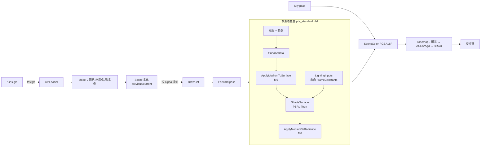

# 03 · 网格、glTF 与 PBR（M3）

## 解决的问题
1. 从文件加载真实模型（glTF 2.0），包括贴图、材质与节点层级。
2. 建立 **shader 公共库**与 **`SurfaceData → ShadingModel`** 固定接口：新增材质只写「怎么填表面属性」，改光照只改一处。
3. 物理正确的直接光（Cook-Torrance）+ 简单但可信的环境光，并用色调映射把 HDR 压到屏幕。
4. 为 M6（材质读取介质）与 M7（toon 角色）留好接口：所有材质已经调用 `SampleMedium` / `ShadeSurface`。

## 代码地图
| 文件 | 内容 |
|---|---|
| [engine/render/GltfLoader.cpp](../engine/render/GltfLoader.cpp) | fastgltf → 统一顶点格式、材质、贴图（sRGB/线性判断）、节点展开 |
| [engine/render/Material.h](../engine/render/Material.h) | 材质参数（64 字节 push constant）+ 5 张贴图 |
| [engine/render/Lighting.h](../engine/render/Lighting.h) | 太阳/天空/环境光/曝光/色调映射参数 |
| [engine/render/passes/ForwardPass.cpp](../engine/render/passes/ForwardPass.cpp) | 按材质绑定贴图与 push constant；坏管线 → 错误材质 |
| [engine/render/passes/SkyPass.cpp](../engine/render/passes/SkyPass.cpp) | 只在深度 = 0 的像素画天空 |
| [engine/world/Scene.h](../engine/world/Scene.h) | 实体（上一步/当前步变换）+ 生成渲染列表（插值） |
| [shaders/common/surface.hlsli](../shaders/common/surface.hlsli) | `SurfaceData`、法线贴图 |
| [shaders/common/lighting.hlsli](../shaders/common/lighting.hlsli) | `LightingInputs`（唯一的光照输入） |
| [shaders/common/brdf.hlsli](../shaders/common/brdf.hlsli) | D / V / F、环境 BRDF 近似 |
| [shaders/common/shading.hlsli](../shaders/common/shading.hlsli) | `ShadePBR`、`ShadeSurface`（toon 的分派点） |
| [shaders/common/sky.hlsli](../shaders/common/sky.hlsli) | 解析天空、半球环境光 |
| [shaders/common/medium.hlsli](../shaders/common/medium.hlsli) | 介质接口（M6 前为「空气」恒等实现） |
| [shaders/common/tonemap.hlsli](../shaders/common/tonemap.hlsli) | ACES（Hill 拟合）、AgX |
| [shaders/materials/pbr_standard.hlsl](../shaders/materials/pbr_standard.hlsl) | glTF 金属-粗糙度材质 |
| [tools/make_test_assets.py](../tools/make_test_assets.py) | 生成测试模型 `assets/models/ruins.glb` |

## 数据流

## 关键公式

**渲染方程（只有一个方向光 + 环境光）**

$$L_o(v) = f(l, v)\, E_{sun}\, (n\cdot l) + L_{ambient}$$

**Cook-Torrance 微表面 BRDF**

$$f(l,v) = \underbrace{\frac{(1-F)(1-m)\,\rho}{\pi}}_{\text{漫反射}} + \underbrace{D(h)\,V(l,v)\,F(v,h)}_{\text{镜面}}$$

- 法线分布（GGX）：$D(h) = \dfrac{\alpha^2}{\pi\left((n\cdot h)^2(\alpha^2-1)+1\right)^2}$，其中 $\alpha = \text{roughness}^2$
- 可见性（高度相关 Smith）：$V = \dfrac{0.5}{(n\cdot l)\sqrt{(n\cdot v)^2(1-\alpha^2)+\alpha^2} + (n\cdot v)\sqrt{(n\cdot l)^2(1-\alpha^2)+\alpha^2}}$，已包含 $\frac{1}{4(n\cdot l)(n\cdot v)}$
- 菲涅尔（Schlick）：$F = F_0 + (1-F_0)(1-v\cdot h)^5$，$F_0 = \text{lerp}(0.04,\ \rho,\ m)$

**环境光（近似）**：漫反射用半球插值 $\rho_d \cdot \text{lerp}(\text{ground}, \text{sky}, \frac{n_y+1}{2})$；镜面用反射方向的天空颜色乘以 Karis 的环境 BRDF 解析近似（split-sum 的第二项）。粗糙表面把反射颜色向漫反射环境光过渡，近似「模糊的环境图」。

**法线矩阵**：$N = (M^{-1})^T$ 与余子式矩阵成正比，3×3 余子式的三列是 $c_1\times c_2,\ c_2\times c_0,\ c_0\times c_1$。法线最终要归一化，所以只需保留 $\det M$ 的符号（见 `mesh.hlsli` 的 `TransformNormal`）。

**太阳盘辐亮度**：照度 $E$ 均匀分布在立体角 $\pi r^2$ 上，$L_{disk} = E / (\pi r^2)$。真实值超过 RGBA16F 上限（65504），所以钳制。

**AgX**：先对数编码 $x' = \frac{\log_2 x - EV_{min}}{EV_{max} - EV_{min}}$，再过 S 形曲线（6 次多项式拟合）。在对数域里压缩，所以高亮处自然去饱和，色相不跑。

## 为什么这样设计
- **材质参数用 push constant**：ImGui 拖动即时生效；不需要为每个材质管理 GPU 缓冲及其跨帧同步。代价是每个 draw 只能有 64 字节材质参数——不够时再改为常量缓冲。
- **sRGB vs 线性贴图**：baseColor/emissive 存的是 sRGB 编码值，用 `_SRGB` 格式让硬件采样时转回线性；法线、粗糙度、AO 是数据，必须用 `_UNORM`，否则数值被扭曲。加载器根据「哪个材质槽位引用了这张图」自动判断。
- **天空在 Forward 之后画**：被遮住的像素直接被深度测试剔除。
- **`discard` 需要 `shaderDemoteToHelperInvocation`**：dxc 以 Vulkan 1.3 为目标时把 `discard` 编译为 demote，被丢弃的像素继续参与导数计算，alpha 裁剪边缘的 mip 选择更正确。

## 本里程碑修掉的一个同步 bug（值得读）
同步验证层报告：「layout transition 与之前的深度写入没有充分同步」。场景：
Forward 写深度 → Sky 只读深度（barrier 只让写入对**读**可见）→ 下一帧 Forward 清深度（布局转换本身是**写**）。
第三步的 barrier 只等了 Sky 的读取，没有显式包含最初那次写入。修复：Render Graph 为每个资源单独记录「最近一次写入」，任何写入或布局转换的 barrier 都把它加入 src。回归测试见 `test_rendergraph.cpp`「回归：写 → 只读 → 下一帧写」。

## 扩展点（`// EXTEND:`）
| 位置 | 可以改什么 | 注意 |
|---|---|---|
| `shading.hlsli` `ShadeSurface` | M7 加 `ShadeToon` | toon 必须使用同一个 `LightingInputs` |
| `lighting.hlsli` `LightingInputs` | 阴影、介质、多光源 | 改结构体后所有着色模型自动获得 |
| `medium.hlsli` | M6 水线湿润、焦散、吸收 | 只改这一个文件 |
| `sky.hlsli` `SkyRadiance` | 物理大气散射 | 保持签名不变，PBR 环境光自动受益 |
| `ForwardPass::pipelineFor` | 按着色模型选管线 | 新管线要用相同的 set 1 布局 |
| `GltfLoader.cpp` | 蒙皮、动画、KHR_texture_transform、BLEND 透明 | BLEND 需要单独的透明 pass 并排序 |
| `world/Scene.h` | 物理句柄（M4） | 只在 `fixedUpdate` 里改 `current` |

## 练习
1. 在「材质」面板里把金色球的粗糙度拖到 0，观察天空反射；再把太阳仰角拖到 5°，看 AgX 和 ACES 在暖色高光处的差异。
2. 在 `brdf.hlsli` 里把 `V_SmithGGXCorrelated` 换成不相关版本 $G_1(l)G_1(v)$，对比高粗糙度球的边缘亮度。
3. 把 `DIELECTRIC_F0` 改成 0.02（水的值），保存后看热重载结果。M5 的海面会用这个值。
4. 写一个新材质 `materials/checker.hlsl`：用世界坐标生成棋盘格 albedo，其余复用 `ShadeSurface`。体会「材质只负责填 SurfaceData」。
5. 用 `--model` 加载任意 glTF 模型（例如 Khronos 的 DamagedHelmet.glb），切换调试视图检查法线和粗糙度贴图是否被正确解读。
6. 在调试视图里看遗迹石头的法线：灰缝处的法线应向内倾斜。如果方向反了，问题出在哪个约定上？（提示：glTF 的 +Y 指向贴图上方。）
