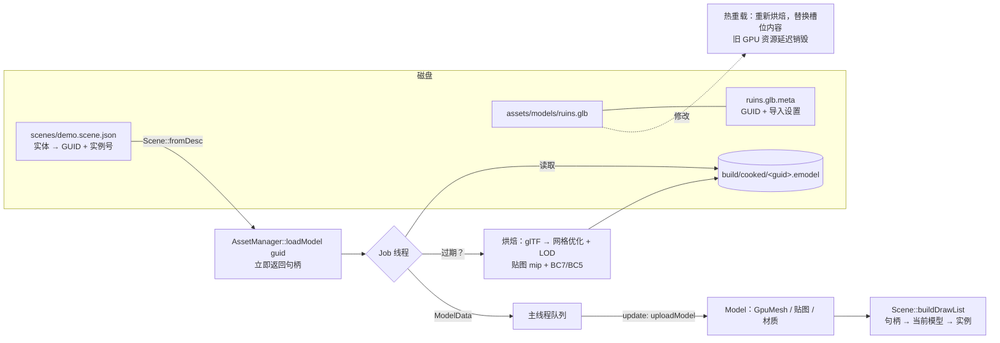

# 04 · 资源层（M3.5）

## 解决的问题
1. **资产身份**：场景里怎么「指向」一个模型？用路径的话，改名/移动就断。
2. **加载太慢、太占显存**：glTF 网格没优化、没有 LOD；PNG 要在加载时解码，不能压缩，一张 4K 贴图未压缩就占 64 MB（2 GB 预算下放不了几张）。
3. **加载会卡住编辑器**：在主线程解码、压缩、上传，界面会停几秒。
4. **热重载后引用悬空**：资产在 Blender 里改完重新导出，GPU 资源整个换掉，场景里的指针还指着旧的。
5. **场景写死在代码里**：没法保存、没法用编辑器搭场景。

## 代码地图
| 文件 | 内容 |
|---|---|
| [engine/core/JobSystem.h](../engine/core/JobSystem.h) | 线程池 + 主线程任务队列 |
| [engine/core/Guid.h](../engine/core/Guid.h) | 128 位 GUID |
| [engine/core/BinaryIO.h](../engine/core/BinaryIO.h) | 带越界检查的二进制读写 |
| [engine/asset/AssetDatabase.h](../engine/asset/AssetDatabase.h) | 源资产 ↔ GUID ↔ 烘焙产物；`.meta`；按需烘焙 |
| [engine/asset/Cookers.h](../engine/asset/Cookers.h) | 贴图（mip + BC7/BC5）、网格（meshoptimizer + LOD） |
| [engine/asset/CookedFormats.h](../engine/asset/CookedFormats.h) | `.emodel` / `.etex` 二进制格式 |
| [engine/asset/AssetManager.h](../engine/asset/AssetManager.h) | 句柄、后台加载、主线程上传、兜底、热重载、内置几何体 |
| [engine/render/Model.h](../engine/render/Model.h) | `ModelData`（CPU）与 `Model`（GPU）两种形态 |
| [engine/world/Scene.h](../engine/world/Scene.h) | 实体 = 模型句柄 + 实例号 + 材质覆盖；LOD 选择 |
| [engine/world/SceneDesc.h](../engine/world/SceneDesc.h) | 场景文件 JSON（容错读取） |

## 数据流

## 关键设计

### GUID 与 .meta
第一次扫描到 `ruins.glb` 时生成随机 128 位 GUID，写进 `ruins.glb.meta`（与源文件一起提交 git）。场景文件只记 GUID，所以改名、移动目录都不影响引用。`.meta` 里还有导入设置（LOD 级数、是否压缩……），改了保存就会自动重新烘焙。
外部文件（`--model D:\xxx.glb`）不往用户目录写 `.meta`，GUID 由路径哈希得出，只做临时登记；拖进窗口的文件则复制到 `assets/imported/` 成为正式资产。

### 烘焙：什么时候、做什么
缓存过期 ⇔ 缓存不存在 ∨ 缓存比源文件或 `.meta` 旧 ∨ 文件头里的烘焙器版本 ≠ `kCookerVersion`。改了烘焙算法时把 `kCookerVersion` 加一，所有缓存自动重建。

**贴图**
- mip 在**线性空间**里求平均：sRGB 值直接平均会让小 mip 整体偏暗。法线先解码到 $[-1,1]$ 求平均再重新归一化（平均后的法线变短，长度越短表示该区域越粗糙 —— EXTEND：可以把这个长度转成粗糙度，即 Toksvig 方法）。
- 压缩：颜色 → **BC7 sRGB**，数据（ORM）→ **BC7 线性**，法线 → **BC5**（只存 XY，shader 重建 $z = \sqrt{1 - x^2 - y^2}$）。BC7/BC5 每像素 1 字节，是 RGBA8 的 1/4。
- 按块行在 Job 线程上并行压缩。

**网格**（meshoptimizer）
1. 去重顶点 → 2. 顶点缓存优化 → 3. 过绘制优化（阈值 1.05）→ 4. LOD 链 → 5. 按首次使用重排顶点（取数局部性）。
LOD：每一级都从 LOD0 简化，目标三角形数减半，误差上限为网格尺寸的 2%；简化不下去（< 5% 减少）就停。所有 LOD 共用顶点缓冲，只是索引缓冲里的不同区段。

### LOD 选择（屏幕空间误差）
每一级记录简化带来的几何误差 $\varepsilon_i$（米）。投影到屏幕上的像素误差：

$$e_{px} = \frac{\varepsilon_i \cdot s}{d} \cdot \frac{H}{2\tan(\mathrm{fov}/2)}$$

$s$ 是实体缩放，$d$ 是相机到包围球表面的距离，$H$ 是视口高度。选 $e_{px} \le$ 阈值（默认 1 像素）的最粗一级。阈值在「渲染设置」里可调，配合线框模式可以直观看到切换。

### 句柄、后台加载与兜底
`loadModel` 立即返回句柄（槽位下标）。Job 线程完成烘焙和解析后，把「上传 GPU」作为任务排进主线程队列；主线程每帧 `update()` 最多执行 4 个，分摊卡顿。
加载中/失败时 `model(handle)` 返回**兜底模型**（品红棋盘立方体）—— 和错误材质同样的思路：缺了什么一眼可见，但程序照常运行。
热重载失败时保留旧模型，和 shader 热重载一致。

### 实体引用与材质覆盖
`Entity = 模型句柄 + 实例号 + 可选材质参数覆盖`。演示场景里的沙地、材质球都是「内置几何体 + 参数覆盖」；检视器里改参数只影响当前实体，保存场景时一起写入。

## 容错
| 情况 | 结果 |
|---|---|
| 场景文件 JSON 语法错误 | 报错，保留当前场景；启动时则生成演示场景 |
| 场景里某个实体字段错误 | 跳过该实体并警告，其余照常 |
| 场景引用的 GUID 不存在 | 实体保留，显示兜底立方体，大纲里标 ✖ |
| 烘焙文件损坏/截断 | 读取失败 → 当作过期 → 下次加载重新烘焙 |
| 热重载时新文件导入失败 | 保留旧模型 |
| `.meta` 损坏 | 不覆盖它，本次按临时资产处理并报错 |

## 编辑器
- **资源 → 模型**：所有资产及状态（◆ 就绪 / ◌ 加载中 / ✖ 失败 / ○ 未加载），「放入」放到相机前方，「↻」删除缓存重新导入。
- **把 .glb / .gltf / .png 拖进窗口**：复制到 `assets/imported/`，生成 `.meta`，后台烘焙，完成后放进场景。
- **文件菜单**：新建 / 打开 / 保存（Ctrl+S，同时保存配置）/ 另存为场景。
- **Delete** 删除选中实体；大纲右键菜单：聚焦、隐藏、删除。
- 检视器显示资产状态、GUID、LOD 各级三角形数；材质修改写入实体覆盖。

## 扩展点（`// EXTEND:`）
| 位置 | 可以改什么 | 注意 |
|---|---|---|
| `CookedFormats.h` | 增加 KTX2 输出，便于与外部工具交换 | 需要写数据格式描述块（DFD） |
| `Cookers.cpp` 法线 mip | Toksvig：用平均法线长度提高粗糙度 | 需要在烘焙时同时修改粗糙度贴图 |
| `AssetDatabase::importExternal` | 复制 .gltf 引用的 .bin 与贴图 | 解析 glTF 的 uri |
| `Scene::instantiate` | 模型加载完成后自动补齐实例 | 目前编辑器通过「延迟放置」规避 |
| `JobSystem` | 任务图、工作窃取 | 动画/物理并行时需要 |
| `AssetManager::update` | 每帧上传数量按耗时预算而非个数 | 大贴图上传可能单个就很慢 |

## 练习
1. 删除 `build/cooked/` 后启动，观察日志里的烘焙耗时；把 `.meta` 里的 `maxLods` 改成 2，保存，看编辑器里 LOD 链变化（自动热重载）。
2. 在「渲染设置」里把 LOD 误差阈值调到 16 像素，打开线框，飞远观察遗迹石柱切换 LOD。
3. 把一个 Poly Haven 的 glTF 模型拖进窗口，看它被导入、烘焙、放进场景的全过程；保存场景后重启，确认它还在。
4. 把 `ruins.glb.meta` 的 `compressTextures` 改成 false，对比状态栏显存变化。
5. 给 `TextureCookSettings` 加一个「最大尺寸」选项（超过就先缩小），想想应该在 mip 生成之前还是之后做。
