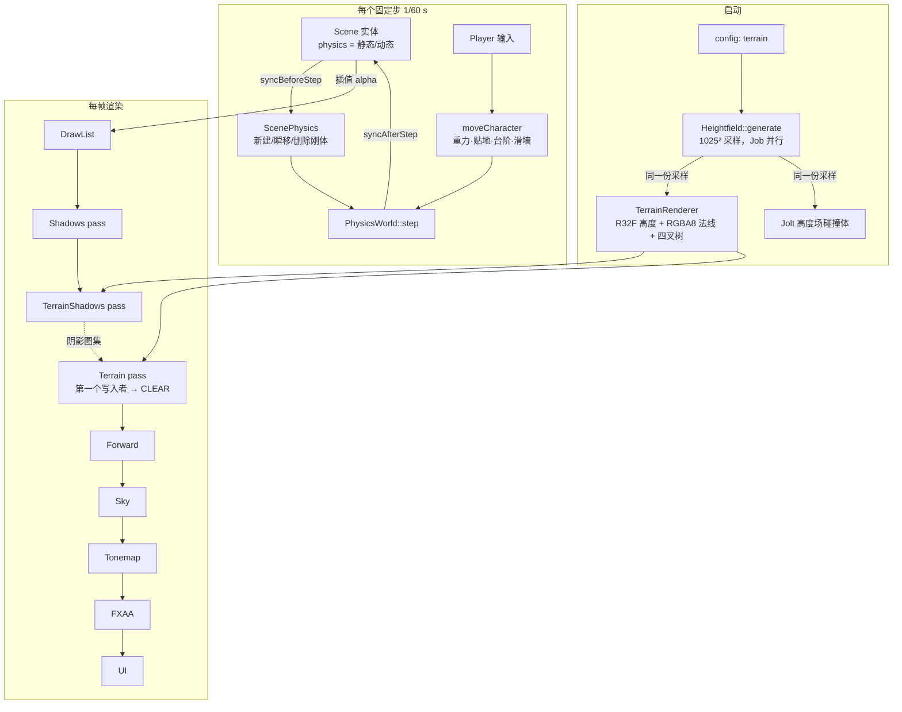

# 05 · 地形、物理与阴影（M4）

## 解决的问题
1. **世界只有一块平面**：需要一座「看得见、走得上去」的岛 —— 有海床、沙滩、丘陵，近处精细、远处便宜。
2. **没有阴影**：物体像贴在地上的贴纸，看不出高度和体积；「光即叙事」也无从谈起。
3. **东西不会掉、角色不能走**：需要刚体、碰撞，以及一个能上坡、跨台阶、沿墙滑动的角色控制器。
4. **画面与物理不一致**：渲染的地面和站立的地面如果来自两份数据，角色会陷进地里或悬空。
5. **锯齿**：高对比的几何边缘（遗迹、石柱）在 1080p 下锯齿明显。

## 代码地图
| 文件 | 内容 |
|---|---|
| [engine/render/Shadows.h](../engine/render/Shadows.h) | 级联阴影的 CPU 计算：切分、包围球、纹素对齐、反向 Z 正交投影 |
| [engine/render/passes/ShadowPass.h](../engine/render/passes/ShadowPass.h) | 网格画进阴影图集（4 个象限 = 4 个级联） |
| [shaders/common/shadow.hlsli](../shaders/common/shadow.hlsli) | `SampleSunShadow`：选级联、法线偏移、3×3 PCF —— 所有材质共用 |
| [engine/render/passes/FxaaPass.h](../engine/render/passes/FxaaPass.h) | 色调映射之后的 FXAA |
| [engine/render/RenderFeature.h](../engine/render/RenderFeature.h) | 特性模块挂进渲染器的接口（阴影 / 不透明 / 半透明三个阶段） |
| [engine/terrain/Heightfield.h](../engine/terrain/Heightfield.h) | 程序化岛屿高度场（渲染与物理共用同一份） |
| [engine/terrain/TerrainQuadtree.h](../engine/terrain/TerrainQuadtree.h) | 四叉树 LOD 选择（纯 CPU，可测试） |
| [engine/terrain/TerrainRenderer.h](../engine/terrain/TerrainRenderer.h) | 地形的 GPU 资源与两个 pass |
| [shaders/terrain/](../shaders/terrain/) | 顶点由 `SV_VertexID` 生成；分层材质（高度混合 + 三平面岩石） |
| [engine/physics/PhysicsWorld.h](../engine/physics/PhysicsWorld.h) | Jolt 的薄封装：形状、刚体、射线、角色控制器（头文件里没有 Jolt 类型） |
| [engine/world/ScenePhysics.h](../engine/world/ScenePhysics.h) | 场景实体 ↔ 刚体自动同步 |
| [sandbox/Player.h](../sandbox/Player.h) | 玩家输入、第三人称相机（带碰撞） |
| [tools/make_terrain_textures.py](../tools/make_terrain_textures.py) | 生成四方连续的分层贴图（频域合成噪声） |

## 数据流

## 关键设计

### 级联阴影（CSM）
一张阴影图覆盖 150 m，每个纹素约 4 cm，近处锯齿严重。把相机视锥按距离切成 4 段，每段一张正交阴影图（放在 4096² 图集的 4 个象限里）。切分点用「实用切分」：对数切分（近处细）和均匀切分（远处不至于太稀）的混合：

$$d_i = \lambda \, n \left(\frac{f}{n}\right)^{i/N} + (1-\lambda)\left(n + (f-n)\frac{i}{N}\right)$$

- **包围球而不是包围盒**：相机转动时，切片的包围盒尺寸会变，阴影边缘就会「游泳」；包围球半径与朝向无关（半径再量化到 1/16 m）。
- **纹素对齐**：把光源空间的原点吸附到整数个阴影纹素上，相机平移时阴影不闪烁。
- **光源往后退 `casterExtent`**：级联范围外（例如相机身后的山）的物体也能把影子投进来。
- **反向 Z 正交投影**：近 = 1、远 = 0，和场景投影约定一致，深度比较用 `GREATER_OR_EQUAL`。
- **偏移**：深度偏移 + **法线偏移**（沿法线把采样点挪出表面 $k$ 个纹素，$k$ = normalBias）。法线偏移对掠射角的痤疮更有效，也不太会产生漏光（「彼得潘」现象）。
- **PCF**：3×3 次硬件比较采样（每次本身又是 2×2 双线性），平均得到柔和边缘。

阴影 pass 关掉时，Render Graph 自动把阴影图换成「深度 0」的默认图 → 采样结果处处为 1（照亮），材质 shader 不需要任何分支。

### 地形：一份高度场，三个用途
`Heightfield` 是纯 CPU 数据：渲染上传成 R32F 贴图，物理建成 Jolt 高度场，玩法用 `heightAt()` 查地面。三者用的是同一组采样，所以「看到的地面 = 站立的地面」。

程序化岛屿（[Heightfield.cpp](../engine/terrain/Heightfield.cpp) 的 `islandHeight`）：
1. 到岛心的距离 $d$ 被低频噪声扰动 → 不规则海岸；`smoothstep(0.75, 1.05, d)` 区分陆地和海。
2. 陆地 = 内陆程度² × 山顶高度 × 山脊噪声（$1-|\text{noise}|$ 的平方，形成尖锐山脊）+ 细节 fBm。
3. 海床随离岸距离加深。
4. 原点附近整平成平台（遗迹、出生点）。岛心放在 (0, −140)，平台落在岛南侧的海边低地上 —— M5 的海浪就在旁边。

### 四叉树 LOD 与裙边
所有节点画的都是**同一个** 32×32 格网格块，只是放的位置和尺寸不同：根节点覆盖 1024 m（一格 32 m），叶子覆盖 32 m（一格 1 m = 原始精度）。细分条件：

$$\text{dist}(\text{相机}, \text{节点包围盒}) < \text{节点边长} \times \text{lodDistanceFactor}$$

屏幕上每个格子的大小因此大致恒定。包围盒的高度范围预先算好（自底向上合并），用于视锥剔除。

没有顶点缓冲：VS 用 `SV_VertexID` 算出格点 $(x, z)$，再 `Load` 高度贴图的整数坐标（不插值，和物理完全一致）。
相邻节点级别不同时，粗节点的边上少了顶点，会出现 T 形裂缝；每个网格块四周多一圈**裙边**（向下拉 `skirtDepth × 网格间距`）从下面把裂缝挡住。把裙边深度调到 0、打开线框就能看到裂缝。

阴影 pass 不做相机视锥剔除（身后的山也要投影），而是按每个级联的正交视锥剔除，并用更粗的 LOD。

### 分层材质
四层：沙（低处）、礁（水下）、苔藓（高处）、岩石（陡坡）。基础权重由高度和坡度 $s = 1 - n_y$ 决定，然后做**高度混合**：每层贴图的 alpha 存「高度」，

$$v_i = w_i + h_i,\qquad b_i = \max\big(v_i - (\max_j v_j - \delta),\ 0\big),\qquad \hat b_i = b_i / \textstyle\sum b$$

$\delta$ 是混合宽度。效果是石头从沙子里「冒出来」，而不是两张图半透明叠加。分层用的高度再加一点大尺度噪声，否则分界就是一条笔直的等高线。

- 岩石用**三平面投影**：沿 X/Y/Z 各投影一次，权重 $w = |n|^4 / \sum|n|^4$，陡坡不拉伸；法线用 whiteout 混合。
- 远处平铺的重复感：同一张贴图再按约 5.3 倍尺寸采样一次，随距离混入。
- 海平面附近变湿：颜色变深、粗糙度降低。
- 和所有材质一样，地形 shader 只负责填 `SurfaceData`，光照 `ShadeSurface`、阴影 `SampleSunShadow`、介质 `medium.hlsli` 都是公共函数 —— M6 的水下吸收会自动作用在海床上。

### 物理封装与场景同步
`PhysicsWorld` 是 Jolt 的薄封装（PIMPL）：公开头文件只有 `ShapeId` / `BodyId` / `vec3` 这类引擎类型。碰撞层只有两个（静态 / 运动），静态物体互不检测，放在单独一棵很少更新的宽相树里。

实体只声明 `physics = none / static / dynamic`，`ScenePhysics` 负责剩下的事：
- 静态 → 模型的三角网格；动态 → 模型顶点的**凸包**（Jolt 的三角网格没有体积，算不出质量和惯量，只能静态）。
- 实例相对模型根的矩阵直接烘进碰撞顶点 → 刚体变换 = 实体变换，写回时不用换算。
- 每步「认领」：实体被删、场景被替换、实体被复制，都自动对应到刚体的删除和新建；模型热重载（版本号变化）→ 重建碰撞体。
- 编辑器里拖动了实体 → 刚体瞬移（速度清零）。
- 动态刚体的位置写回 `current`，`previous` 不动 → 渲染插值照常平滑。

### 角色控制器
Jolt 的 `CharacterVirtual`：不是刚体，由代码逐步推进，内部处理沿墙滑动、上台阶（`stepUp`）、下坡贴地（`stickDown`）、推开动态刚体。每步的速度合成：

$$\mathbf v = \begin{cases}\mathbf v_\text{ground} + \text{jump}\cdot\hat{\mathbf y} & \text{着地}\\ (\mathbf v\cdot\hat{\mathbf y})\,\hat{\mathbf y} & \text{空中}\end{cases} \;+\; \mathbf g\,\Delta t \;+\; \mathbf v_\text{wish}$$

期望速度用指数趋近平滑：$\mathbf v_\text{wish} \mathrel{+}= (\mathbf v_\text{input} - \mathbf v_\text{wish})(1 - e^{-k\Delta t})$，与步长无关。起跳速度 $v$ 对应的跳跃高度 $h = v^2 / 2g$（5 m/s ≈ 1.27 m）。

第三人称相机：从角色头顶往相机方向打一条射线，被地形/建筑挡住就把相机拉近（留 0.25 m 余量，近平面不会切进墙里）。

### FXAA
色调映射之后，在 LDR 图上检测亮度对比强的边缘，沿边缘方向做一次小范围混合。代价约 0.1 ms，但会让细小纹理略软；M6.5 做体积云时会引入 TAA，FXAA 保留为低配选项。

## 容错
| 情况 | 结果 |
|---|---|
| 地形分辨率不是 32 × 2ⁿ + 1 | 四叉树拒绝构建并报错，地形不画，其余照常 |
| 分层贴图缺失 / 加载中 | 用白色 + 平坦法线代替，地形照样能画 |
| 碰撞形状创建失败（退化网格等） | 打日志、缓存无效句柄（不每步重试），实体照常渲染 |
| 三角网格被设为动态 | 警告并降级为静态 |
| 刚体数量超上限 | 报错，返回无效句柄 |
| 玩家掉出世界（y < fallLimit） | 回到出生点 |
| 关掉 Shadows / TerrainShadows / Terrain / FXAA pass | 下游自动改读默认资源，不崩溃 |
| 第一次启动就是 `--no-ui` | 编辑器布局按「停靠节点是否存在」判断，回到编辑器时照样生成默认布局 |

## 编辑器
- **▲ 地形与物理**面板：地形开关、线框、按 LOD 着色、LOD 距离系数、裙边深度、各层阈值/尺寸/粗糙度（实时生效）；岛屿生成参数 +「↻ 重新生成」（渲染与碰撞一起更新）；物理统计（刚体数、活动数、每步耗时）、重力；玩家状态与移动参数。
- **渲染设置**：FXAA 开关；阴影距离、切分 λ、深度/法线偏移、PCF 半径、图集尺寸，实时显示 4 个级联边界。
- **检视器**：实体的「碰撞」模式（无 / 静态 / 动态）。
- **游戏模式（F1）**：WASD 移动、Shift 冲刺、空格跳、鼠标转视角、滚轮远近、R 重生。
- 命令行：`--camera x,y,z,yaw,pitch`（编辑器相机初始位置）、`--terrain-lod`（LOD 着色），截图对比参数时很方便。

## 扩展点（`// EXTEND:`）
| 位置 | 可以改什么 | 注意 |
|---|---|---|
| `TerrainQuadtree.h` | 限制相邻级别差 / CDLOD 顶点渐变（geomorphing） | 渐变需要在 VS 里知道父节点的高度 |
| `TerrainRenderer.h` | 实例化绘制或 GPU 驱动的四叉树 | 节点参数放进存储缓冲 |
| `ShadowPass.cpp` | 每个级联先做视锥剔除 | 地形阴影已经这样做了，可以照抄 |
| `RenderFeature.h` | M5 海洋在 `addTransparentPasses` 画水面；M6.5 新增天空阶段 | 阶段顺序决定 pass 顺序 |
| `FxaaPass.h` | M6.5 引入 TAA | 需要运动矢量与抖动投影 |
| `PhysicsWorld.cpp` 碰撞层 | 加「角色」「触发器」「投射物」层 | 同时改两张过滤表 |
| `PhysicsWorld.h` | Jolt 的 JobSystem 接到引擎 JobSystem | 现在是两个线程池 |
| `Player.h` | M8 战斗状态机、锁定目标相机 | 状态机放玩法层，不进引擎模块 |

## 练习
1. 「地形与物理」面板里打开「按 LOD 着色」和「线框」，调 LOD 距离系数，观察节点如何随距离变粗；把裙边深度调到 0，找一找 LOD 交界处的裂缝。
2. 改随机种子、岛心位置、山顶高度后点「重新生成」，进游戏模式（F1）爬上山顶 —— 坡度超过 50° 的地方会滑下来。
3. 在「渲染设置」里把切分 λ 从 0 拖到 1，对比近处阴影的清晰度；把法线偏移调到 0，看地面上出现的阴影痤疮。
4. 把一个材质球的碰撞改成「动态」，点 ▶ 运行，它会滚下平台；用角色把木箱金字塔推倒。
5. 给 `TerrainSettings` 加一个「沙丘」噪声层，只作用在 `sandMaxHeight` 以下 —— 改的是 `islandHeight` 一个函数，渲染和物理会一起变。
6. 进阶：把 `TerrainShadows` pass 关掉，解释为什么山的影子消失了，但山本身的明暗（$N\cdot L$）还在。
