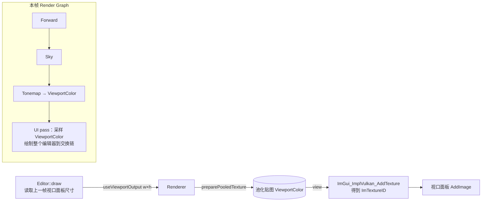

# 编辑器界面

参考 UE / Unity 的布局，界面分成「看场景」「找东西」「改东西」「看状态」四类区域，位置固定、各司其职。

```
┌ 菜单栏：文件 编辑 视图 渲染 模拟 工具 帮助                         ◆ OCEAN ENGINE ┐
├ 工具栏：‖暂停 ▶|单步 ×1 │ 视图模式 ▦线框 ☀天空 │ ◉截图 ●捕获帧 ↻Shader ✔保存 │ 编辑器 ▶游戏 ┤
├────────────┬─────────────────────────────────────────┬────────────────────┤
│ ☰ 场景大纲  │ ◆ 视口                                   │ ◉ 检视器             │
│ （分组/搜索/ │   左上：视图模式·线框·速度·聚焦            │ （选中实体：变换、   │
│  可见性）   │   右上：分辨率·FPS·GPU，下方坐标轴指示器    │  网格、材质）        │
│            │   右下：操作提示                          │                    │
├────────────┤                                         ├────────────────────┤
│ ▤ 资源      ├─────────────────────────────────────────┤ ☀环境光照 ◐渲染设置   │
│ （材质色块/ │ ☰日志 ◔性能 ▦Render Graph ✎Shader         │ ⚙项目设置（标签页）   │
│  网格列表） │                                         │                    │
├────────────┴─────────────────────────────────────────┴────────────────────┤
└ 状态栏：● 就绪 │ FPS CPU GPU │ 显存条 │ 视口分辨率        选中 相机 Validation 错误 ┘
```

## 设计要点
| 设计 | 为什么 |
|---|---|
| **场景渲染到离屏贴图，显示在「视口」面板里** | 视口大小由面板决定，相机宽高比、点选坐标都以视口为准；其他面板不再遮挡场景 |
| **F1 游戏模式** | 场景直接画到交换链、全屏，只留角落的帧率。检查最终画面用 |
| **状态栏背景色反映整体状态** | 正常为青色、模拟暂停为橙色、有 shader 错误为红色。不用盯着看，余光就能注意到 |
| **工具栏只放最常用的开关** | 模拟控制、视图模式、截图/捕获、shader 重编、保存；其余在菜单和面板里 |
| **标签页不显示关闭按钮** | 停靠面板满屏的 × 很乱也容易误关；开关统一在「视图」菜单，「视图 → 重置布局」恢复默认 |
| **语义颜色统一** | 青 = 强调/激活，橙 = 选中/警告，红 = 错误，绿 = 正常。日志、状态栏、Render Graph、视口高亮都一样 |
| **空状态给出提示** | 检视器没有选中物体时告诉你怎么选，而不是一片空白 |
| **太阳方位盘** | 俯视天空半球：拖动太阳点同时改仰角和方位角，比两个滑条直观；配合「清晨/正午/黄昏/月夜」预设一键切换 |

## 视口交互
| 操作 | 效果 |
|---|---|
| 右键拖动 + WASD / QE | 飞行（鼠标必须在视口内；转视角时鼠标被锁定，ImGui 暂时忽略鼠标） |
| 滚轮 | 调整移动速度 |
| 左键 | 点选物体：屏幕坐标 → 世界射线 → 与每个实体的世界包围盒求交，取最近的（`math/Geometry.h`） |
| F / 双击 | 聚焦：相机保持朝向，平移到能完整看到选中物体包围球的位置 |
| Esc | 取消选择；游戏模式下返回编辑器 |

选中的物体会在渲染时叠加一点橙色自发光（只改这次 draw 的 push constant，不改材质本身）。

## 快捷键
F1 编辑器/游戏 · F5 暂停/继续模拟 · F6 单步 · F9 截图 · F12 RenderDoc 捕获 · Ctrl+S 保存配置 · Ctrl+R 重编全部 shader

## 代码地图
| 文件 | 内容 |
|---|---|
| [engine/editor/Editor.h](../engine/editor/Editor.h) | `EditorContext`（编辑器能访问的引擎状态）、`SimulationControl` |
| [engine/editor/Editor.cpp](../engine/editor/Editor.cpp) | 外壳：菜单、工具栏、状态栏、停靠布局、视口、点选、快捷键 |
| [engine/editor/EditorPanels.cpp](../engine/editor/EditorPanels.cpp) | 场景大纲、资源、检视器、环境光照、渲染设置、项目设置 |
| [engine/editor/EditorTheme.cpp](../engine/editor/EditorTheme.cpp) | 「深海」配色与控件辅助 |
| [engine/debug/StatsPanel.cpp](../engine/debug/StatsPanel.cpp) | 日志、性能面板 |
| [engine/debug/RenderPanels.cpp](../engine/debug/RenderPanels.cpp) | Render Graph、Shader 面板 |
| [engine/render/Renderer.cpp](../engine/render/Renderer.cpp) | `useViewportOutput` / `useBackbufferOutput`：两种输出目标的 Render Graph |
| [tools/update_ui_glyphs.py](../tools/update_ui_glyphs.py) | 扫描界面文字，生成缺失汉字列表 |

## 视口贴图的数据流



- 视口贴图需要在**构建界面时**就拿到 view（`ImGui::Image` 要用），而普通瞬态贴图要到 Render Graph 执行时才分配。所以 `RenderGraph::preparePooledTexture` 提前按尺寸准备好同名池化贴图，之后声明同名资源即复用它。
- UI pass 声明「采样 ViewportColor」，Render Graph 会在 UI 之前插入 COLOR_ATTACHMENT → SHADER_READ_ONLY 的 barrier；下一帧 Tonemap 写入前，也会等待 UI 的读取（跨帧 WAR）。
- 面板尺寸变化 → 新贴图 → 新的 ImGui 描述符；旧描述符通过 `Device::deferDestroy` 延迟释放（在途的帧可能还在用）。

## 扩展点（`// EXTEND:`）
| 位置 | 可以改什么 | 注意 |
|---|---|---|
| `Editor::pickAt` | GPU ID 缓冲做像素级点选 | 包围盒点选在镂空处（拱门中间）会误选 |
| `EditorPanels.cpp` `kPresets` | 光照预设放进 `config/` 做成数据 | |
| `ImGuiLayer.cpp` 图标字体 | 换成 Font Awesome 等图标字体 | 以 MergeMode 合并，注意字形范围 |
| `Editor::buildDefaultLayout` | 调整默认布局比例/位置 | 改完删除 `build/imgui_editor_v1.ini` 或用「视图 → 重置布局」 |
| 检视器 | 加变换操纵杆（如 ImGuizmo） | 需要视口的 view/proj 和矩形 |
| `EditorContext::projectSettingsExtra` | 应用自己的参数 | 显示在「项目设置」末尾 |

## 练习
1. 在「环境光照」里拖动太阳方位盘，观察材质球高光的位置；然后点「黄昏」预设，切换 ACES / AgX 对比橙色高光。
2. 把固定步长调到 5Hz、时间缩放 ×0.25，再按 F6 单步，观察旋转立方体：暂停时渲染插值停在哪里？
3. 给场景大纲加一个右键菜单：「聚焦」「隐藏其他」。
4. 给状态栏加一项「已保存/未保存」：参数改动后显示橙色圆点，保存后消失。
5. 把 `pickAt` 改成：按住 Ctrl 点击时只选中材质（检视器直接显示材质），体会 `m_selection` 与 `m_selectedMaterial` 的关系。
